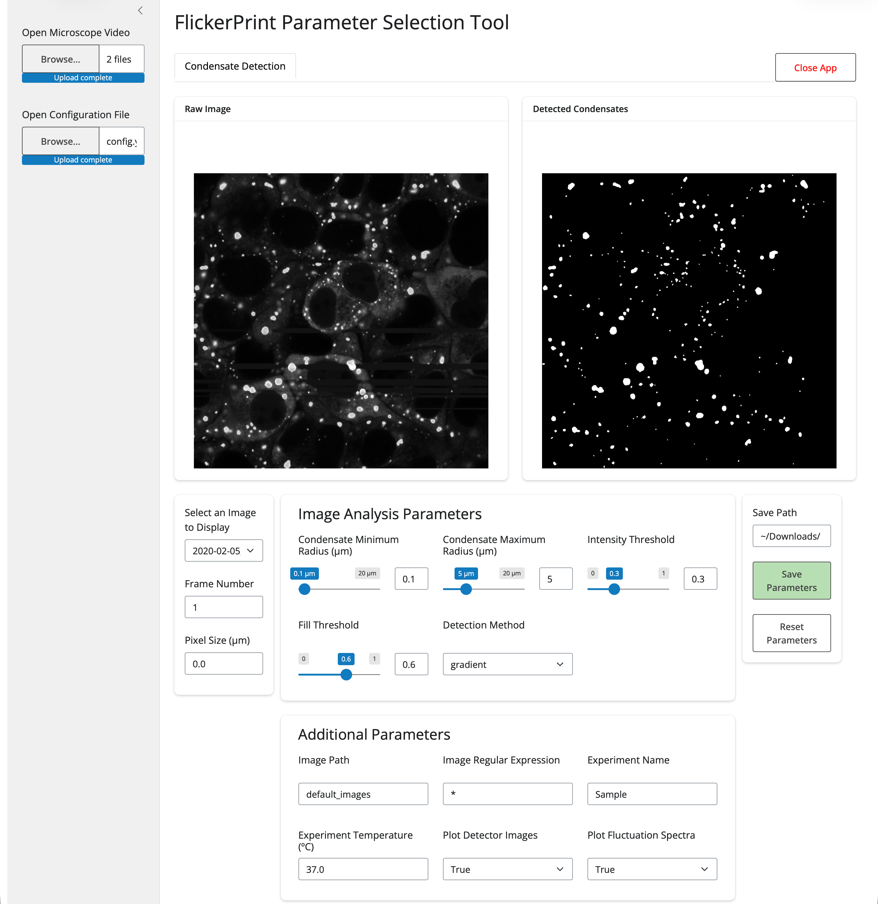
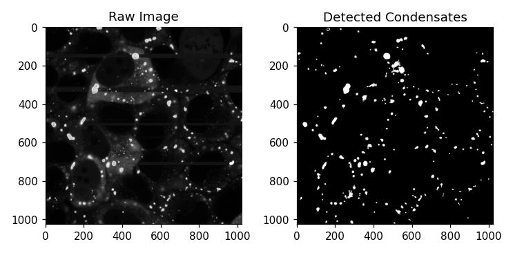
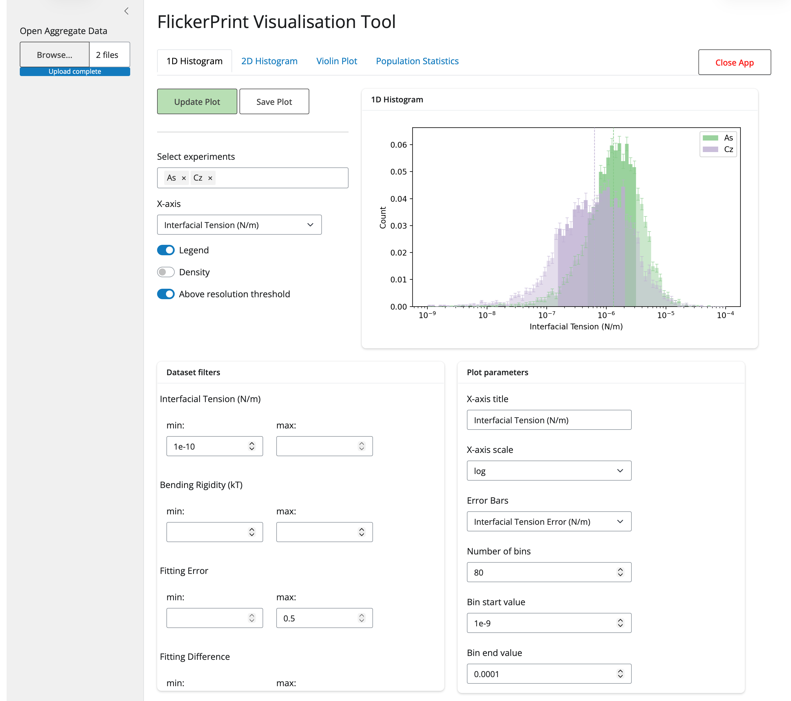

.. _worked_example:

Worked Example
==============

In this page, we will work through an example usecase of FlickerPrint.

We assume that you have a working installation of FlickerPrint.
If this is not the case, follow the :ref:`installation` instructions.

An example microscope image is provided `here <https://www.ebi.ac.uk/biostudies/bioimages/studies/S-BIAD1763>`_.
This image shows stress granules in live U2OS cells; G3BP1 has been tagged in this case.
The stress granules have formed in response to treatment with sodium arsenite.

.. caution::
    
    Some caveats with this exercise:

    * This microscope image is quite short (only 133 frames long). This is primarily to cut down on the file size and the amount of computation for the exercise. Ideally, microscope images used with FlickerPrint should be :math:`\sim` 1000 frames long.
    * **The results from a single microscope image (particularly one this short) may not provide an accurate representation of the properties of your sample.** As we will see later, the interfacial tension and bending rigidity can span multiple orders of magnitude. Therefore, to provide an accurate picture you should aim to image as many condensates as possible as this will provide the best statistics.

Getting Set up
--------------

Before, starting the analysis, we need to create an experiment directory so that FlickerPrint knows where to work.
Using the terminal (or command prompt in Windows), navigate to where you would like to put your experiment directory and run

.. code-block:: bash

    flickerprint creat-project example_project

which will create an experiment directory called ``example_project``.
Use ``cd example_project`` to move into this directory.

Run the command

.. code-block:: bash

    flickerprint parameter-selection

to open the parameter selection tool in your default web browser, as shown in Figure 1.

    Figure 1: The parameter selection tool, which can be used to adjust the parameters for the analysis.

Open the microscope image linked above in the parameter selection tool by clicking the ``Open Microscope Video`` button and selecting the file you downloaded, or dragging and dropping it onto the ``Open Microscope Video`` button.

The first frame of the file will be displayed on the left and the detected granules will be shown on the right.

.. note::
    
    In this case, the default values in the configuration file should be correct for finding the condensates in the image.
    However, in other cases, you may need to adjust the imaging parameters to find most of your condensates.
    Additional information can be found in the :ref:`getting_started` section.

You will still need to change the following parameters:

* ``Image Path`` - The path to the image files (or the path to a single image file). Leaving this as ``default_images`` specifies the ``images`` folder of the experiment sub-directory.

* ``Experiment Name`` - Human readable name for the experiments, used in organisation and plotting. Experiments with the same name will be combined by the plotting routines.

* ``Plot Detector Images`` - Whether to plot the images of the detected condensates and their boundaries.

* ``Plot Fluctuation Spectra`` - Whether to plot the fluctuation spectra for each condensate.

Once you are happy with the parameters, set a save location for the configuration file (save to the ``experiment directory`` directly or save to yuor downloads folder and move the file manually), and click ``Save Parameters``.

Running FlickerPrint
--------------------

FlickerPrint can be run by calling

.. code-block:: bash

    flickerprint run

from the experiment directory.

The analysis is split into two main steps.
In the first, we locate the condensates in the image, track them through the frames and determine the position of their boundaries.

The results of this analysis can be found in the *tracking* directory. 
The detection folder contains an output for every 100 :sup:`th` frame. 
The left plot shows the location of the detected granules and the right plot shows the raw frame from the microscope file. 
These plots are intended to be used to ensure that granules have been located correctly. 
An example of one of these images can be seen in Figure 2.

    Figure 2: An example image from the *tracking* directory. The left plot shows the original frame from the microscope file; the right plot shows the locations of the granules and their approximate extent, as detected by the granule detection algorithm.

In the outline directory, an image of each granule for every 100 :sup:`th` frame and its boundary is produced. If the boundary is white, then the granule has been accepted for further analaysis; if it is red, then the granule has been rejected for this frame.

.. figure:: ./images/granules_outline.png 
    :alt:     Figure 3: The images of two granules, together with their outlines, as determined by the boundary detection algorithm. a) shows an accepted granule (as shown by the complete, white outline) and b) shows a rejected granule (as shown by the incomplete, red outline). In this case, the granule depicted in b) is likely two granules that are in the process of merging. The blue dot shows the centre of the granule, as determined by the boundary detection algorithm.
    
    Figure 3: The images of two granules, together with their outlines, as determined by the boundary detection algorithm. a) shows an accepted granule (as shown by the complete, white outline) and b) shows a rejected granule (as shown by the incomplete, red outline). In this case, the granule depicted in b) is likely two granules that are in the process of merging. The blue dot shows the centre of the granule, as determined by the boundary detection algorithm.

Also output at this stage of the analysis is *<imagename>.h5*, found in the *fourier* sub-directory, where *<imagename>* is the name of the original microscope image file. This contains the numerical data from the first stage in the analysis, including the location of each granule and its fourier components. For more information on the contents of this file, please see the :ref:`fourier.h5` section.

Fitting the fluctuation spectra
-------------------------------

The second component of the analysis involves fitting the Fourier modes for each granule to the theoretical spectrum given by

.. math::
    \left<|\nu_q|^2\right> = \dfrac{k_BT}{\kappa}\sum_{l=q}^{l_{max}}{\dfrac{N_{lq}^2 P_{lq}^2(0)}{(l+2)(l-1)[l(l+1)+\bar{\sigma}]}},

where :math:`\kappa` is the bending rigidity and :math:`\bar{\sigma} = \sigma R^2/\kappa` is the reduced interfacial tension.
This allows the bending rigidity :math:`\kappa` and interfacial tension :math:`\sigma` to be determined for each granule as the only free parameters to the fit.
Full details and a derivation of this spectrum can be found `here <https://doi.org/10.1126/sciadv.adg0432>`_.

Plots showing the fluctuation spectrum and series of heatmaps showing the quality of fit of the theoretical spectrum to the experimental data are produced for each granule. These can be found in the *fitting/spectra* and *fitting/heatmaps* sub-directories respectively.

The spectra show the magnitude of the fluctuations as blue circles with the best-fit theoretical spectrum shown in black. Also shown are the magnitudes of the total purturbations (including any constant terms due to the time-averaged base shape) of the Fourier modes, plotted as red tri-points. 

The heatmaps show the :math:`\kappa - \bar{\sigma}` paramterspace, around its minimum. The first plot in the image shows the heatmap with the defualt colour scaling; the second uses a logarithmic scaling to highlight the minumum more easily. Also shown in the second plot are the best fit value (plotted as a black circle) and the actual minimum of the paramter space (plotted as a red circle). The final plot in each image is a copy of the spectrum for that granule. 

.. figure:: ./images/fluctuation_spectra.png
    :alt: Example fluctuation spectra.

    Figure 4: The fluctuation spectra produced for two different granules. The interfacial tension :math:`\sigma` and the bending rigidity :math:`\kappa` and their respective uncertainties are displayed at the top of each plot.

.. figure:: ./images/heatmaps.png
    :alt: Example heatmpas for two granules.

    Figure 5: Heatmaps from the spectrum fitting of two granules. Sub-figures a-c represent the fitting shown in figure 4a and sub-figures d-f represent the fitting shown in figure 4b. Sub-figures 5a and 5d show the :math:`\kappa - \sigma` parameterspace, using the default colour scaling. Sub-figures 5b and 5e show the parameterspace with a logarithmic colour scaling. Sub-figures 5c and 5f show a basic plot of the fluctuation spectra, as is done in more detail in the spectrum plots shown in figure 4.

Also output at this stage in the analysis is the file *aggregate_fittings.h5* which contains the properties of each granule and its fitting information. 
This is the final output from the main FlickerPrint workflow.
For more information, please see the :ref:`aggregate_fittings.h5` section.

Visualising the Output
----------------------

``aggregate_fittings.h5`` can be opened and analysed in any standard data analysis software.

However, FlickerPrint also contains tools to assist with visualising the outputs.

The automatic analysis will produce figures showing the distribution of interfacial tension and bending rigidity, as well as all other measured parameters (mean radius, circularity, etc.) in the ``figs`` subfolder of the experiment directory.

If you would like to customise the figures (for example, by changing the filtering options), you may wish to use the interactive app which can be run by calling

.. code-block:: bash

    flickerprint view-output

and will open in a web browser window.

    Figure 6: The visualisation tool, which can be used to explore the results of the analysis.

